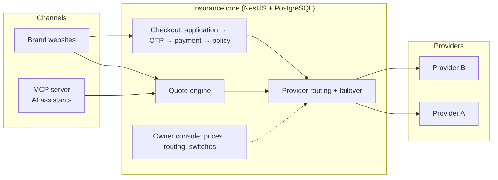

# Multi-brand insurance platform — architecture case study

How an online car insurance service in Ukraine ([TEHET](https://tehet.com.ua)) is built: one provider-neutral core, brands as configuration, several insurance providers behind one interface.

The production code is commercial and closed. This repository has the architecture, the decisions behind it, and two small **open examples** written from scratch for this case study.

## The shape



- **Brands are configuration, not forks.** Name, domain, prices and insurer switches are set per brand. A customer never sees a provider's internal name, commission or raw response.
- **Provider-neutral core.** Every provider sits behind one interface: quote, application, OTP, payment, policy. A new provider is an adapter, not a rewrite.
- **Failover.** If one provider is down, quotes come from another; the owner decides in the console what each channel sells.

## Decisions and why

| Decision | Why |
|---|---|
| Personal data in provider payloads is encrypted at rest | Applications contain passports and addresses. Operations can query the database without seeing them. |
| Every refusal has a **public error code** with a sentence the customer can act on | «Something went wrong» loses customers at the last step. A technical failure at an insurer says «your data is fine, pick another insurer» and keeps the form filled. |
| After a refusal, other insurers are offered immediately, with the form carried over | The customer does not type everything again — and usually completes the purchase with another insurer. |
| **Checkout pauses in the last minutes before midnight** | A policy starting «today» cannot be issued once «today» is over. A payment at 00:01 for yesterday's application leaves the customer paid and without a policy. See [`examples/checkout-midnight-pause`](examples/checkout-midnight-pause). |
| Background traffic to providers is rate-limited | One quote can fan out into many requests on the provider's side. Monitoring and price sampling must stay small next to real customer traffic. |
| Plates are normalized before any lookup | Plates arrive in Cyrillic, Latin and mixed look-alike letters. See [`examples/ua-plate`](examples/ua-plate). |
| AI assistants get a public, read-only MCP server | People ask assistants «how much is car insurance in Lviv». The [MCP server](https://github.com/DemydDK/tehet-mcp) answers with live, dated, indicative prices and a link to buy. |

## How the work runs

- **Every change leaves a work log**: the state before, what changed and why, the tests, the deploy and the rollback point.
- **Staging is separate from production**; production changes need an explicit approval.
- **AI agents as a team**, each with its own area and written guardrails, sharing one log of lessons learned.

## Examples (open source, MIT)

| Example | What it shows |
|---|---|
| [`examples/ua-plate`](examples/ua-plate) | Normalizing Ukrainian licence plates: Cyrillic/Latin look-alikes, spaces and dashes, format check. Zero dependencies. |
| [`examples/checkout-midnight-pause`](examples/checkout-midnight-pause) | A time-zone-safe «no new applications or payments in the last N minutes before midnight» guard, with summer/winter time tests. |

```bash
cd examples/ua-plate && node --test
cd examples/checkout-midnight-pause && node --test
```

Requires Node.js 20+.
